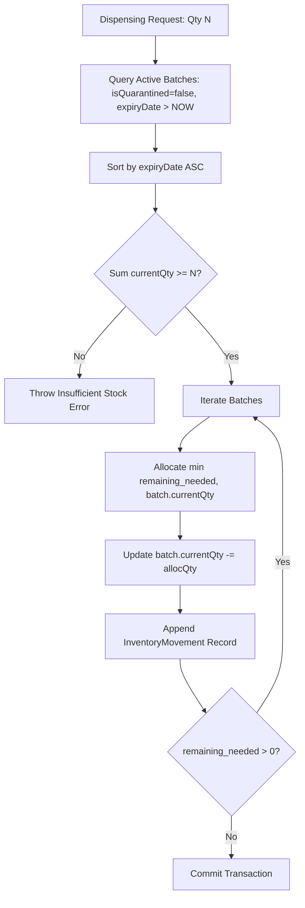

# Pharmacy Management System: Architecture & Design

## 1. Domain Entities & Database Model

```
+----------------+       +-------------------+       +-----------------------+
|   Medication   | 1---* |  MedicationBatch  | 1---* |   InventoryMovement   |
+----------------+       +-------------------+       +-----------------------+
| id             |       | id                |       | id                    |
| ndc            |       | medicationId      |       | batchId               |
| brandName      |       | lotNumber         |       | medicationId          |
| genericName    |       | expiryDate        |       | movementType          |
| deaSchedule    |       | initialQty        |       | quantityChange        |
| unitPriceCents |       | currentQty        |       | previousBalance       |
| costPriceCents |       | isQuarantined     |       | newBalance            |
| reorderLevel   |       +-------------------+       | actorId               |
+----------------+                                   | referenceType         |
                                                     | referenceId           |
                                                     +-----------------------+
```

### 1.1 FEFO Strategy


## 2. Controlled Substance Register

Perpetual log for controlled pharmaceuticals (Schedule II - V):
1. **Prescriber Verification**: NPI and DEA numbers validated against format patterns.
2. **Patient Identification**: Photo ID type (e.g., Driver's License, Passport, State ID) and ID hash recorded.
3. **Dual Review**: Dispensing requires authenticated pharmacist session credentials.
4. **Perpetual Balance**: Before and after quantities logged to immutable audit records.

## 3. Financial Exactitude
To prevent rounding discrepancies common in healthcare point-of-sale systems:
- Prices and balances are represented as 64-bit integers in minor currency units (cents).
- `\$19.99` is stored and calculated as `1999`.
- Subtotals, line-item discounts, and sales tax percentages are computed with integer rounding algorithms (`Math.round((subtotalCents * taxRateBps) / 10000)`).
