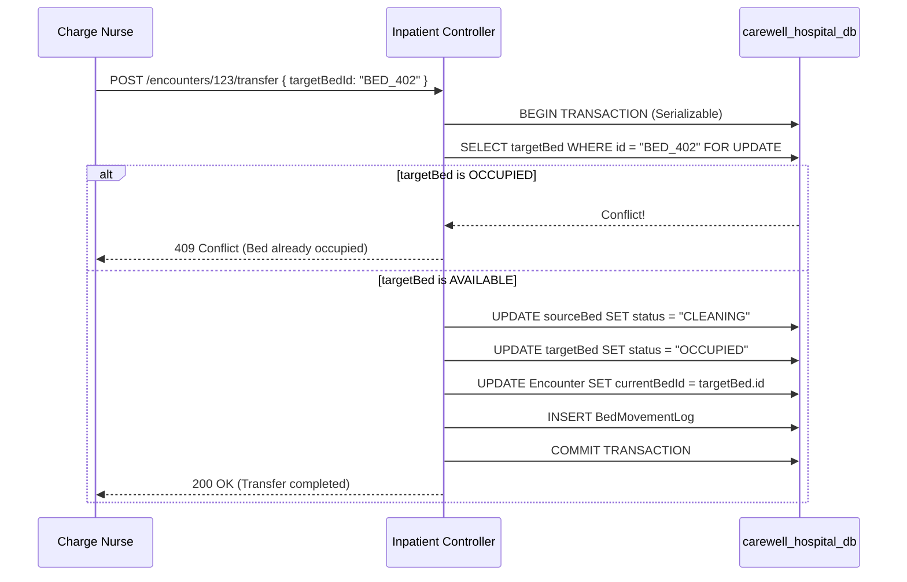

# Hospital Management System: Architecture & Design

## 1. Domain Entities & Database Model

```
+----------------+       +-------------------+       +-----------------------+
|    Patient     | 1---* |     Encounter     | 1---* |     ClinicalNote      |
+----------------+       +-------------------+       +-----------------------+
| id             |       | id                |       | id                    |
| mrn            |       | patientId         |       | encounterId           |
| fullName       |       | encounterType     |       | authorId              |
| dateOfBirth    |       | attendingDoctorId |       | noteType (SOAP)       |
| bloodType      |       | primaryNurseId    |       | content               |
| allergiesJson  |       | currentWardId     |       | isSigned              |
+----------------+       | currentBedId      |       | signedAt              |
                         | admissionDate     |       | parentNoteId          |
                         | dischargeDate     |       +-----------------------+
                         | status            |
                         +-------------------+
                                  |
                                  | 1---*
                         +-------------------+       +-----------------------+
                         |     LabOrder      | 1---* |       LabResult       |
                         +-------------------+       +-----------------------+
                         | id                |       | id                    |
                         | testName          |       | numericValue          |
                         | testCode          |       | referenceRange        |
                         | status            |       | isAbnormal            |
                         | orderedById       |       | enteredById (Tech)    |
                         +-------------------+       | verifiedById (Path)   |
                                                     | verifiedAt            |
                                                     +-----------------------+
```

## 2. Inpatient Bed Allocation & Transfer Engine


## 3. Laboratory 4-Eyes Verification State Machine
```
[ORDERED] 
    ↓ (Phlebotomy Collection)
[SPECIMEN_COLLECTED] 
    ↓ (Lab Tech Data Entry)
[RESULT_PENDING_VERIFICATION] (Hidden from general chart)
    ↓ (Pathologist Review & Signature)
[VERIFIED_AND_RELEASED] (Visible in patient chart)
```

## 4. Break-Glass Emergency Audit Log
When `POST /encounters/:id/break-glass` is invoked:
1. Validates clinician credentials.
2. Checks mandatory `justificationReason` (min 15 characters).
3. Creates temporary 4-hour emergency access token.
4. Generates an immutable `AuditLog` entry with action `EMERGENCY_BREAK_GLASS`.
5. Emits real-time notification alert to Hospital Privacy & Security Officer.
